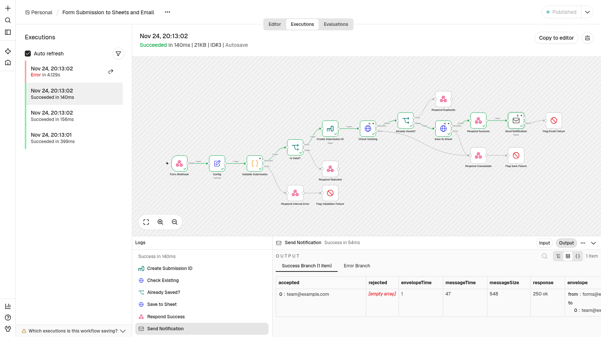
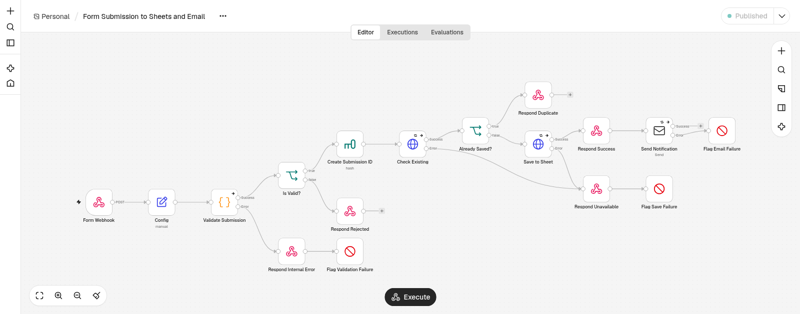
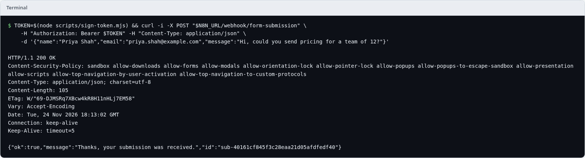
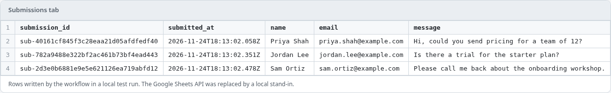
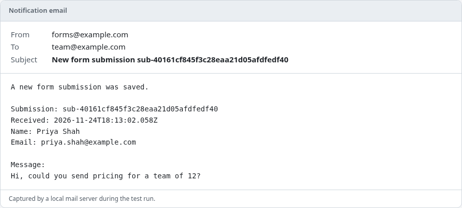
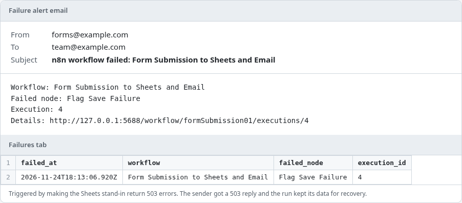

# Form Submission Workflow for n8n

## Overview

An n8n workflow that receives website form submissions, saves them to Google Sheets, and emails a notification. It's for small teams that want a reliable form backend without writing or hosting a server. It deals with what usually goes wrong with form automations: spam, duplicate submissions, injected spreadsheet formulas, and outages that lose submissions without anyone noticing.

- Simultaneous submissions can't overwrite each other's rows, because Google's atomic append endpoint picks the row.
- Every failure is logged to a `Failures` tab and emailed as an alert. The failed run keeps the submitted data for 14 days so it can be recovered.
- Requests need a signed token that expires within 5 minutes, so a leaked token stops working almost immediately.
- 89 automated tests run the exact validation code that ships inside the workflow. The workflow was also tested on a live n8n server with 1,800 extra submissions and a mail server made to stall on purpose.

```text
Webhook → Config → Validate → Valid? ─ yes → Create ID → Already saved? ─ no → Save ─ ok → 200 → Email
                      │          │                            │             │                  └ fail → failed run
                      │          │                            └ yes → 200   └ fail → 503 → failed run
                      │          └ no → 400 / 401 / 415 / 422 (202 for bots)
                      └ crash → 500 → failed run
```

## Demo

These screenshots come from a real run of the workflows in n8n 2.48.8. Google Sheets and the mail server were replaced by local stand-ins, so the sheet and email images show the data the workflow actually sent, in a plain layout.

A successful run. Every step on the success path is green, and the notification email was accepted by the mail server:



The full workflow, including the branches for duplicates, rejected input, and failures:



Sending a test submission with a short-lived token:



The rows the workflow saved, and the notification email for the first one:





When Google Sheets returned errors, the sender got a `503`, the failure was logged, and an alert was sent with a link to the run:



## Tech stack

- **n8n 2.x** (tested on 2.48.8): the workflow engine. Uses the Webhook, Code, IF, Crypto, HTTP Request, Email Send, Respond to Webhook, Stop and Error, and Error Trigger nodes.
- **JavaScript (ES modules)**: the validation logic that runs in the Code node, plus the build and token scripts.
- **Node.js 24+**: required by n8n. It also runs the build, the tests, and the token script. The project has no npm dependencies.
- **Google Sheets API v4** with OAuth2: stores submissions and the failure log through the `values:append` endpoint.
- **SMTP**: sends notification emails and failure alerts.
- **JSON Web Tokens (HS256)**: short-lived webhook authentication, signed with Node's built-in `crypto` module.
- **node:test**: Node's built-in test runner, used for the unit and workflow-structure tests.

## Getting started

### Prerequisites

- An n8n 2.x instance you can import workflows into (self-hosted, with CLI access for the import commands below).
- Node.js 24 or later on the machine where you run the tests and sign tokens.
- A Google account for the sheet and an SMTP account for sending email.

### Install

```bash
git clone https://github.com/undefinedcringe/n8n-form-workflow.git
```

```bash
cd n8n-form-workflow && npm test
```

`npm test` rebuilds `workflows/` from the source files and runs the tests.

### Set up

1. Create a Google Sheet with two tabs and these headers in row 1:

   ```text
   Submissions: submission_id | submitted_at | name | email | message
   Failures:    failed_at | workflow | failed_node | execution_id
   ```

2. Apply the server settings in `deploy/n8n.env.example` to your n8n environment.
3. Import the error workflow first, then the form workflow:

   ```bash
   n8n import:workflow --input=workflows/error-alert.json
   ```

   ```bash
   n8n import:workflow --input=workflows/form-submission.json
   ```

4. Create three credentials in n8n and select them on the matching nodes:
   - JWT Auth on `Form Webhook`. Use key type Passphrase, algorithm HS256, and a secret from `openssl rand -hex 32`.
   - Google Sheets OAuth2 on `Check Existing`, `Save to Sheet`, and `Log Failure`.
   - SMTP on `Send Notification` and `Send Error Alert`.
5. Replace the `REPLACE_WITH_*` values in the `Config` node of both workflows.
6. In the form workflow's settings, confirm that Error Workflow is `Form Workflow Error Alert`. If you imported through the n8n editor instead of the CLI, the ID changed and you must select it again.
7. Publish both workflows.

### Run

Set your n8n URL and the same JWT secret you used for the credential:

```bash
export N8N_URL="https://your-n8n.example.com" FORM_JWT_SECRET="your-secret"
```

Send a test submission:

```bash
TOKEN=$(node scripts/sign-token.mjs) && curl -i -X POST "$N8N_URL/webhook/form-submission" -H "Authorization: Bearer $TOKEN" -H "Content-Type: application/json" -d '{"name":"Test User","email":"test@example.com","message":"Hello"}'
```

A `200` reply means the row was saved. The notification email follows a moment later.

To connect a real website form, keep `FORM_JWT_SECRET` on your server. Your backend or serverless function should sign a fresh token per request with `signToken` from `scripts/sign-token.mjs`, forward the form to n8n, and rate-limit requests. Add a hidden, empty `website` input as a bot trap. You can also send an `idempotency_key` of 16 to 64 letters, digits, hyphens, or underscores with each form. Without one, identical content within 10 minutes counts as a duplicate.

## Challenges & solutions

### Concurrent submissions could overwrite each other

**Problem.** n8n's built-in Google Sheets node reads the whole sheet, works out the next empty row, and writes to it. Two submissions arriving together can pick the same row, and one silently replaces the other.

**What I tried.** The built-in node was my first choice. Reading n8n's source showed how it chooses the row, and that it loads the entire sheet into memory on every save.

**What worked.** Calling the Sheets API's `values:append` endpoint directly with the HTTP Request node. Google chooses the row atomically. The duplicate check reads only the ID column, so memory stays flat as the sheet grows.

**What I learned.** An "append" option in a UI isn't always an atomic append. For anything that writes shared data, I now check how the write actually happens.

### A stalled mail server could hang runs and swallow alerts

**Problem.** If an SMTP server accepts the connection and then stops responding, the email node waits about 10 minutes per attempt. n8n can't interrupt it sooner.

**What I tried.** I moved the email into a sub-workflow with a 45-second timeout. It didn't work: n8n only checks sub-workflow timeouts between nodes, so the hung email kept running and the run got stuck. A run that is cancelled by a timeout also never starts the error workflow, so no alert would be sent.

**What worked.** The workflow replies to the sender before sending any email, so they never wait. Email gets 2 attempts, and the run timeout (1,500 seconds) outlasts both of them, so the failure is always reported. Against a mail server that stalled on purpose, the alert arrived after 1,202 seconds.

**What I learned.** Timeouts in a system I don't control need testing against a real hang. The documented behavior wasn't enough to predict what happened.

### Request headers end up in the run history

**Problem.** n8n saves raw request headers with each run. The editor hides the `Authorization` header on screen, but the stored value is still in the database. A fixed API key would sit there for anyone with database access.

**What I tried.** A static key in a header was the simple option. Seeing how n8n stores runs ruled it out. With JWT auth instead, I found that n8n accepts tokens that have no expiry at all.

**What worked.** Short-lived HS256 tokens signed per request by the website's backend. The validation code also rejects any token without an expiry or with more than 5 minutes left, so a token copied from the run history is useless within minutes.

**What I learned.** Where a secret gets stored matters as much as how it's checked. I also don't assume a library enforces every claim I expect.

### An invisible character broke the validation code

**Problem.** The validator strips Unicode line and paragraph separators, which can break the layout of emails and sheet cells. The `
` and `
` escapes in its regular expression were written into the file as the raw characters. JavaScript treats those as line breaks, so the Code node failed to parse.

**What worked.** Matching the characters by Unicode category (`\p{Zl}\p{Zp}` with the `u` flag) so the source contains only plain ASCII. A regression test now runs the shipped code against both characters, and it fails if the code stops parsing.

**What I learned.** Generated code needs to be tested in the place it will run, not only read. The bug was invisible in an editor.

### Failed runs looked like successes

**Problem.** Nodes that catch an error and route it to a reply branch mark the whole run as successful. With successful runs set to be discarded, those submissions would be deleted and no alert would fire.

**What I tried.** Routing errors to a `503` reply alone. The sender saw the error, but n8n treated the run as fine. Separately, the error workflow didn't run at all during testing until I found that it has to be published too.

**What worked.** A Stop and Error node after each error reply. The sender still gets a clear status code, and n8n marks the run as failed, keeps its data for recovery, and starts the alert workflow. The setup steps now say to publish both workflows.

**What I learned.** A platform's idea of "failed" can differ from mine. I now test the failure path end to end, alert included.

## Reference

### Responses

| Status | Meaning |
| --- | --- |
| 200 | Saved, or already saved. The notification email is sent after this reply. |
| 202 | Honeypot triggered. Nothing was stored. |
| 400 | The body is not a form or JSON object. |
| 401/403 | The token is missing, invalid, expired, or valid for too long. |
| 415 | The request is not JSON or URL-encoded, or it includes a file. |
| 422 | A field is invalid. `errors` lists which one. |
| 500 | Unexpected validation error, which is kept as a failed run, or a request over the server size limit, which n8n rejects before the workflow starts. |
| 503 | Google Sheets failed after retries. It is safe to retry with the same data. |

### Recovering a failed submission

Open the run linked in the alert email or listed in the `Failures` tab, and copy the data from its `Validate Submission` node. With the recommended settings, failed runs are deleted after 14 days.

### Known limits

- Two identical requests that arrive at the same moment can both pass the duplicate check. They create two rows with the same `submission_id`, which makes them easy to spot, and no other data is overwritten. Disabling the submit button after the first click prevents most of these.
- A network failure during a save can do the same if Google stored the row but the reply was lost.
- If a mail server accepts a connection and then stalls, the alert can take up to about 20 minutes. The sender is unaffected because they already have their reply.
- Testing used a live n8n server with stand-in Google Sheets and SMTP services. Run the test request against your own sheet and mail server before relying on it.

### Development

```bash
npm test
```

Edit `src/validate-submission.js` or `scripts/build.mjs`, not the generated files in `workflows/`.

## License

Released into the public domain under the [Unlicense](LICENSE).
